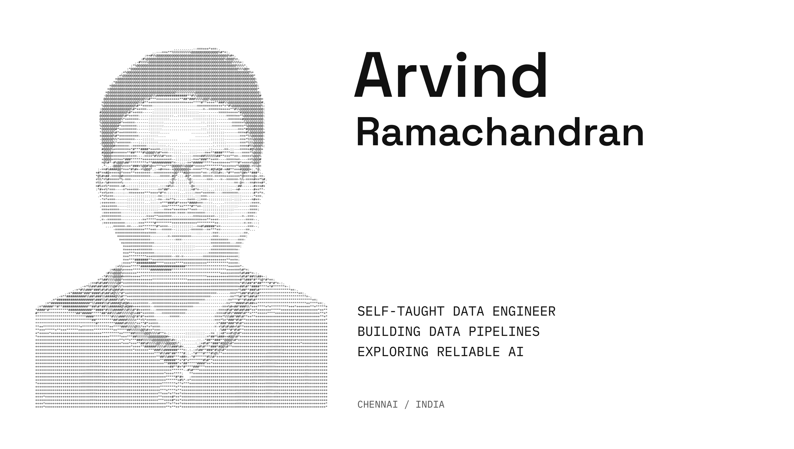

<samp>

<strong>+-- 01 / ABOUT</strong>

Hi, I'm Arvind. 
Self-taught data engineer. Chennai, India.

I build data pipelines and explore how AI agents can work within clear permissions and limits.

My focus is reliability: keeping bad data visible, making results traceable and knowing what a system has actually done.

&gt; <a href="https://arvindramachandran.tech/">Portfolio</a>

<strong>+-- 02 / SELECTED WORK</strong>

<strong><a href="https://github.com/arvindram27/CartProof">[01] CartProof</a></strong>

Built for the Meta Global AI Developer Hackathon.

Cart-state verification and bounded recovery for shopping agents. Checks observed state against the baseline and requested change rather than trusting an agent's success claim.

Python / Meta API / Shopify Storefront API 
Scope: controlled synthetic-cart demo with an intentionally dropped action. No checkout or orders. Not a general shopping service.

<strong><a href="https://github.com/arvindram27/retail-feed-standardizer">[02] Retail Feed Standardizer</a></strong>

Synthetic retail feeds into Delta tables. Row validation, quarantine and count and value reconciliation.

PySpark / Delta Lake 
Scope: small-scale learning project.

<strong><a href="https://github.com/arvindram27/multi-agent-market-intelligence">[03] Multi-Agent Market Intelligence</a></strong>

A LangGraph workflow for market research. Source evidence and human approval before business results are saved to Postgres.

LangGraph / PostgreSQL 
Scope: agent-control libraries are tested offline and are not enabled in the default app.

<strong><a href="https://github.com/arvindram27/ai-cost-margin-pipeline">[04] AI Cost &amp; Margin Pipeline</a></strong>

Usage costing and simulated customer margins. Exact arithmetic, explicit unpriced usage and replayable outputs.

Python / DuckDB 
Scope: synthetic data only.

<strong><a href="https://github.com/arvindram27/market-efficiency-detector">[05] Market Efficiency Detector</a></strong>

Research into price adjustment after news. A synthetic PAL demo and a separate candle-based timing study.

Python / Spark 
Scope: research prototype, not a validated trading system.

<strong>+-- 03 / IN PROGRESS</strong>

<strong><a href="https://github.com/arvindram27/servicedesk-copilot">ServiceDesk Copilot</a></strong>

A local-only IT support prototype exploring provider gating, budget reservations and guarded writes.

Python / FastAPI / SQLite 
Scope: synthetic data. The ticket workflow and agent loop are not complete.

<strong>+-- 04 / TOOLBOX</strong>

Python / SQL / PySpark / Delta Lake 
DuckDB / PostgreSQL / LangGraph / FastAPI

+-- end

</samp>

