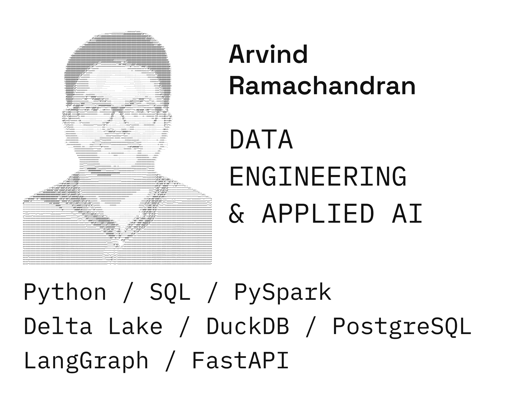

<h2><samp>+-- 01 / ABOUT</samp></h2>

Hi, I'm Arvind.  
Mechanical engineer transitioning into data engineering and applied AI.  
Chennai, India.

I build data pipelines and AI agent workflows. I'm looking for roles in data engineering and AI engineering.

My focus is reliability. I work on data quality and traceable results with clear limits on what an AI agent can do.

<table>
<tr><td>
<samp>&gt; <a href="https://arvindramachandran.tech/">Portfolio</a></samp>
</td></tr>
</table>

<h2><samp>+-- 02 / SELECTED WORK</samp></h2>

<h3><samp>[01] <a href="https://github.com/arvindram27/CartProof">CartProof</a> (Meta Global AI Developer Hackathon 2026 submission)</samp></h3>

<table>
<tr><td>
A shopping agent can say "done" even when an item is missing from your cart or the quantity is wrong. Its success message is not proof that the cart is correct.  
CartProof compares the actual cart with its starting state and the requested change. It checks the items and quantities as well as whether the rest of the cart stayed unchanged. The controlled demo attempts one correction for a missing item and checks the cart again before reporting success.  
<samp>Python / Meta API / Shopify Storefront API</samp> 
Scope: controlled synthetic-cart demo with one deliberately dropped action. No checkout or orders. Not a general shopping service.
</td></tr>
</table>

<h3><samp>[02] <a href="https://github.com/arvindram27/multi-agent-market-intelligence">MAMI / Multi-Agent Market Intelligence</a></samp></h3>

<table>
<tr><td>
Market research needs sources that can be checked and results that can be reviewed. MAMI turns news excerpts into structured analysis with source evidence. A person reviews the results before they are saved to Postgres.  
I'm also building an agent harness around this workflow to control token budgets and data access. It checks writes against the approved target and records decisions and outcomes.  
<samp>LangGraph / PostgreSQL / SQLite</samp> 
Scope: harness controls are tested offline and are not enabled in the default app. The full live harness is not finished.
</td></tr>
</table>

<h3><samp>[03] <a href="https://github.com/arvindram27/market-efficiency-detector">Market Efficiency Detector</a></samp></h3>

<table>
<tr><td>
How long does a price take to adjust after news? MED explores that question through a synthetic Price Adjustment Latency demo and a separate candle-based timing study that keeps missing data visible.  
<samp>Python / Spark / SQLite</samp> 
Scope: research prototype. Not a validated market efficiency detector or trading system.
</td></tr>
</table>

<h3><samp>[04] <a href="https://github.com/arvindram27/retail-feed-standardizer">Retail Feed Standardizer</a></samp></h3>

<table>
<tr><td>
Sales feeds from shops and online stores use different formats. Bad records can get lost during processing and leave gaps in the totals. This pipeline puts accepted rows into a standard Delta table and keeps rejected rows in quarantine with a reason. It checks that row counts and amounts add up.  
<samp>PySpark / Delta Lake</samp> 
Scope: small-scale learning project using synthetic feeds. Re-run safety is not yet implemented.
</td></tr>
</table>

<h3><samp>[05] <a href="https://github.com/arvindram27/ai-cost-margin-pipeline">AI Cost &amp; Margin Pipeline</a></samp></h3>

<table>
<tr><td>
AI usage counts alone do not show what each customer costs to serve. This pipeline turns usage events into estimated costs and simulated customer margins. Usage that cannot be priced stays visible rather than being counted as free.  
<samp>Python / DuckDB</samp> 
Scope: synthetic usage and prices only. Revenue and margins are simulated.
</td></tr>
</table>

<h2><samp>+-- 03 / IN PROGRESS</samp></h2>

<h3><samp><a href="https://github.com/arvindram27/servicedesk-copilot">ServiceDesk Copilot</a></samp></h3>

<table>
<tr><td>
A local-only IT support prototype exploring checks on model providers and token budgets before a request runs. It also explores permission checks before writes.  
<samp>Python / FastAPI / SQLite</samp> 
Scope: synthetic data. The ticket workflow and agent loop are not complete.
</td></tr>
</table>

<h2><samp>+-- 04 / TOOLBOX</samp></h2>

<samp>Python / SQL / PySpark / Delta Lake  
DuckDB / PostgreSQL / LangGraph / FastAPI</samp>

<samp>+-- end</samp>
